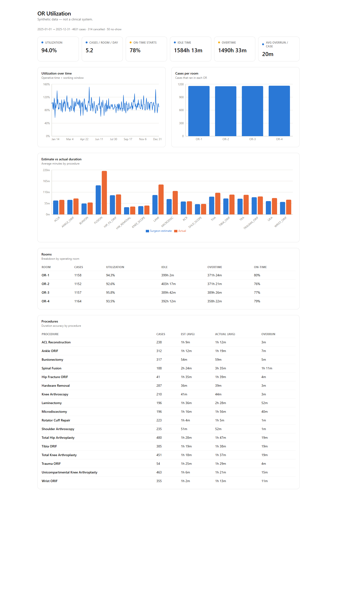
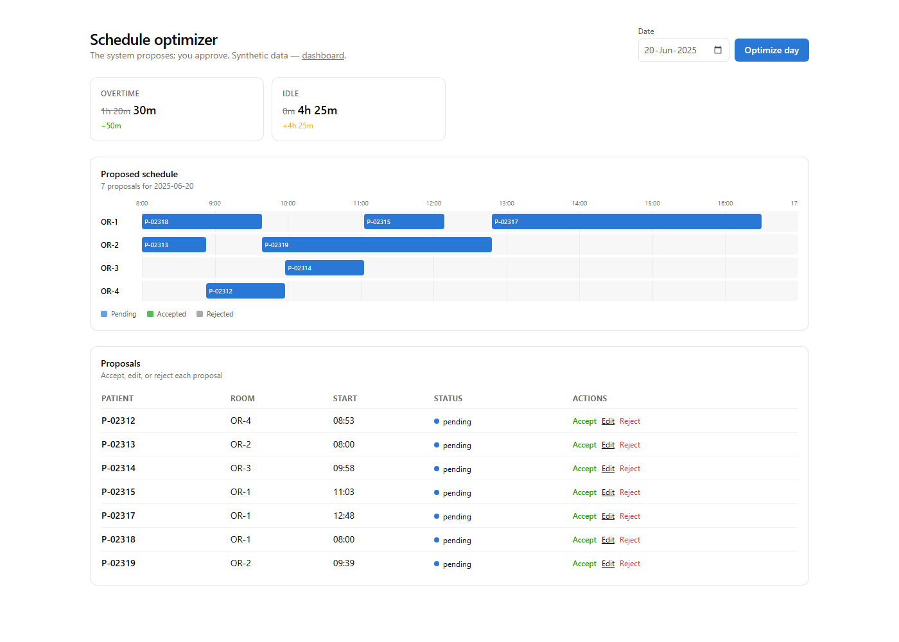

# ORFlow: Operating Room Scheduling & Utilization

A web app that helps hospitals use their operating rooms better: predict how long surgeries take, build smarter daily schedules, and measure the gains against a manual-style baseline.

> **Portfolio project.** All data is **synthetic**. This is not a clinical or production system and must not be used with real patient data.

---

## Why This Project

Operating rooms are a hospital's biggest revenue engine, yet many are still scheduled with phone calls, spreadsheets, and whiteboards. Common costs:

- Idle gaps between cases
- Inaccurate duration estimates, causing overruns and early finishes
- Same-day cancellations
- Unused surgeon block time
- Staff overtime

ORFlow shows how data, prediction, and optimization can reduce these, and how to prove it with numbers.

## Headline Result

On 12 months of simulated orthopedic cases (261 operating days), replayed under
the same actual durations — manual/estimate-based scheduling vs ORFlow
(predicted durations + OR-Tools), plus a duration model that beats surgeon
estimates by **17%** (MAE 25.2 → 20.8 min):

| Metric | Baseline | ORFlow | Change |
|---|---|---|---|
| Overtime (hours/year) | 1,485 | 1,174 | **−21%** |
| On-time first-case starts | 81% | 100% | **+19 pts** |
| Idle gaps (hours/year) | 166 | ~0 | **−100%** |
| Cases per room per day | 5.2 | 4.6 | — |

The overtime and on-time gains are the robust headline (starting on time removes
late-start cascades); the idle figure is the optimized plan's potential.

Isolating the **scheduler's own** contribution: on the 82 days with an add-on
emergency, placing the on-call case in a room with slack (instead of the block
surgeon's full room) cuts overtime on those days a further **8%** — a win
attributable purely to OR-Tools' room assignment. Full method, charts, and
honest limitations: [`docs/results.md`](docs/results.md).

## Screenshots

**Utilization dashboard** (synthetic data): KPIs, utilization trend, cases per
room, estimate-vs-actual duration, and per-room / per-procedure breakdowns.



**Schedule optimizer** — the human-in-the-loop flow: run the optimizer for a
day, review the proposed room/time assignments on a Gantt timeline, and
accept / edit / reject each proposal. Baseline vs optimized metrics are shown
side by side (including trade-offs, e.g. less overtime at the cost of some idle).



## Features

- **Synthetic data generator:** 12 months of realistic orthopedic cases across several ORs (reproducible with a fixed seed)
- **Data import:** CSV/Excel upload with validation
- **Utilization dashboard:** idle time, turnover time, overruns, cases per room, on-time starts
- **Duration predictor:** predicts case length with a confidence range and compares it to the surgeon's own estimate
- **Schedule optimizer:** builds daily schedules with OR-Tools, respecting rooms, surgeons, staff, and turnover time
- **Proposal flow:** the optimizer *proposes*, a coordinator *approves or edits*
- **Audit log:** every schedule change is recorded (who, what, before/after, when)
- **Simulation:** replays the same cases under baseline and optimized scheduling and compares results

## Tech Stack

| Layer | Choice |
|---|---|
| Backend | Python 3.12, FastAPI, SQLAlchemy 2.x, Alembic, Pydantic v2 |
| Database | PostgreSQL |
| Prediction | scikit-learn (`HistGradientBoostingRegressor`, quantile) |
| Optimization | Google OR-Tools (CP-SAT) |
| Charts (results) | matplotlib |
| Frontend | Next.js (App Router), TypeScript, Tailwind CSS, Recharts |
| Tooling | Docker Compose, pytest, ruff, mypy, ESLint, GitHub Actions |

## Architecture

```
 Synthetic data / CSV upload
            |
            v
   Ingestion + validation
            |
            v
 PostgreSQL <----> FastAPI backend <----> Next.js frontend
            |
   +--------+---------+
   |                  |
 Duration          Scheduler
 predictor        (OR-Tools)
   |                  |
   +--------+---------+
            |
   Proposals + audit log
            |
            v
   Simulation: baseline vs optimized
```

## Project Structure

```
orflow/
├── README.md
├── CLAUDE.md               # rules for the AI coding agent
├── docker-compose.yml
├── backend/
│   ├── app/
│   │   ├── api/            # routes (thin)
│   │   ├── models/         # SQLAlchemy models
│   │   ├── services/       # business logic: ingestion, predictor, scheduler
│   │   └── core/           # config, auth, audit logging
│   └── tests/
├── frontend/
│   ├── app/
│   └── components/
├── simulation/             # synthetic data + baseline vs optimized comparison
├── notebooks/              # exploration only
└── docs/                   # architecture, results, screenshots
```

## Core Data Model

- **Hospital, Room, Surgeon, Staff**
- **Procedure** (name, code, specialty)
- **Case** (pseudonymous patient ID, procedure, surgeon, room, scheduled and actual times, status)
- **BlockTime** (surgeon or service, room, day, used or released)
- **Proposal** (suggested schedule change, status: pending / accepted / rejected)
- **AuditEvent** (actor, action, before/after, timestamp, source)

Patients are referenced only by pseudonymous IDs such as `P-00123`.

## Build Roadmap

| Step | Deliverable | Status |
|---|---|---|
| 1 | Project skeleton: Docker, FastAPI health check, Next.js shell, CI | ✅ |
| 2 | Database models and migrations | ✅ |
| 3 | Synthetic data generator | ✅ |
| 4 | CSV/Excel import with validation | ✅ |
| 5 | Utilization dashboard | ✅ |
| 6 | Duration predictor vs surgeon estimates | ✅ |
| 7 | OR-Tools scheduler with proposals and audit log | ✅ |
| 8 | Simulation: baseline vs optimized, results in `docs/results.md` | ✅ |
| 9 | Polish: screenshots, final README (live demo + video optional) | ✅ |

## Getting Started

Prerequisites: Python 3.12, Node 20+, and Docker (for PostgreSQL).

```bash
# 1. Database + backend
docker compose up -d db
cd backend
python -m venv .venv
# Windows: .venv\Scripts\activate   |   macOS/Linux: source .venv/bin/activate
pip install -e ".[dev]"
cp .env.example .env
alembic upgrade head
uvicorn app.main:app --reload          # API at http://localhost:8000 (docs at /docs)

# 2. Frontend (new terminal)
cd frontend
npm install
npm run dev                            # http://localhost:3000/dashboard
```

### Reproduce the data and results

```bash
# a) Generate synthetic CSVs (fixed seed -> reproducible)
cd simulation
python -m venv .venv && <activate>  && pip install -e ".[dev]"
python -m orsim --seed 42 --out output

# b) Import them while the API is running (coordinator role), in order:
#    hospitals, rooms, surgeons, staff, procedures, cases, block_times
curl -F kind=hospitals -F file=@simulation/output/hospitals.csv \
     -H "X-Role: coordinator" http://localhost:8000/import
# ...repeat for the other six files

# c) Train the duration model (writes predictions back to cases)
curl -X POST -H "X-Role: coordinator" http://localhost:8000/predictions/train

# d) Build an optimized day and review proposals
curl -X POST -H "X-Role: coordinator" "http://localhost:8000/schedule/optimize?date=2025-06-16"

# e) Run the baseline-vs-optimized simulation -> docs/results.md + charts
cd backend && python -m app.simulate --out ../docs
```

### Checks

```bash
cd backend   && ruff check . && mypy . && pytest
cd simulation && ruff check . && mypy . && pytest
cd frontend  && npm run lint && npm run typecheck && npm run build
```

## Deployment

- The backend ships a `Dockerfile`; `docker compose up` runs it alongside
  PostgreSQL. Configuration is entirely environment-driven (`backend/app/core/config.py`).
- A live demo needs a host for the API + a managed PostgreSQL, and a static/Node
  host for the Next.js frontend (set `NEXT_PUBLIC_API_URL` to the API). The
  dashboard runs fully client-side against the API.

## Design Principles

- **Human in the loop:** the system proposes; a person approves.
- **Auditability:** every change is traceable.
- **Privacy by design:** synthetic data only, pseudonymous IDs, no secrets in the repo.
- **Configurable rules:** weights, turnover times, and constraints live in settings, not hardcoded.
- **Reproducibility:** fixed seeds so results can be re-run and verified.

## Limitations

- Data is simulated, so real-world accuracy is unproven.
- No integration with hospital systems (EHR).
- Single hospital, single specialty.
- Not validated by clinicians.
- Not a medical device and not intended for production use.

## Future Work

**Toward real-world use**
- Retrain the predictor on real, anonymized hospital data
- Hospital system integration (exports first, then FHIR/HL7)
- Security and compliance work (HIPAA or local equivalent, encryption, access reviews)
- Monitoring, backups, and a manual fallback plan
- Multi-hospital support
- Clinical review of scheduling rules with OR managers

**AI agent phase (not started)**
- Pre-surgery readiness checks (consent, labs, fasting, equipment)
- Reading clinical notes to find missing information
- Automated reminders to staff and patients
- Cancellation-risk prediction and waitlist filling

## License

To be decided.
