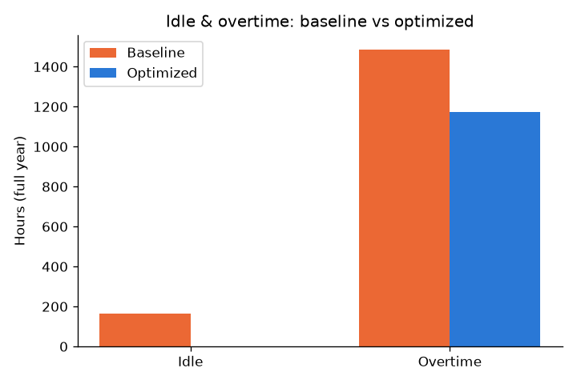
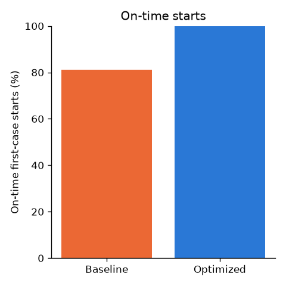

# Results: baseline vs optimized

> **Synthetic data.** Generated by `simulation/`, not real patients. This is a
> portfolio demonstration, not a clinical or production system.

## Method

The same completed cases are replayed two ways under the **same actual
durations**:

- **Baseline** — the manual, surgeon-estimate schedule as it actually ran
  (recorded start/end times), including late first-case starts and the gaps
  left by same-day cancellations.
- **Optimized** — ORFlow's plan (model-predicted durations + the OR-Tools
  scheduler), executed under the same actual durations.

Both are measured the same way: idle is room time sitting empty beyond the
turnover it needs; overtime is time past the 16:00
close; an on-time start is a room's first case beginning within the grace
window.

## Headline

| Metric | Baseline | Optimized | Improvement |
|---|---|---|---|
| Overtime (year) | 1,485h | 1,174h | **+20.9%** |
| On-time first starts | 81% | 100% | **+19.0 pts** |
| Idle gaps (year) | 166h | 0h | **+100.0%** |
| Cases / room / day | 5.17 | 4.62 | — |

Across **261** operating days and **896** room-days, with
**364** same-day cancellations/no-shows in the dataset.

> The **overtime** and **on-time** figures are the robust headline: planning
> with predicted durations and starting each room on time removes the
> late-start cascades that drive manual-schedule overtime. The **idle** figure
> is the plan's potential — the optimized schedule runs cases back-to-back, so
> idle gaps collapse; real execution would reintroduce some idle.





## How to reproduce

```bash
# 1. generate data, 2. import, 3. train the predictor, then:
cd backend
python -m app.simulate --db sqlite:///orflow.db --out ../docs
```

## Honest limitations

- Data is synthetic and the cases are surgeon-locked (each case is tied to its
  surgeon), so per-day room rebalancing has limited headroom; the gains here
  come mainly from starting on time, packing out cancellation gaps, and
  planning with realistic predicted durations rather than optimistic estimates.
- Total operative time per surgeon is fixed, so overtime that is driven purely
  by a surgeon's workload cannot be removed by scheduling alone.
- Not validated by clinicians; not a medical device.
